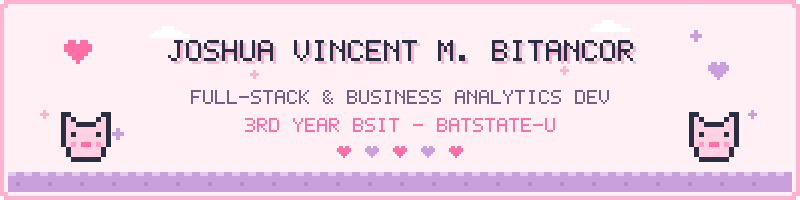
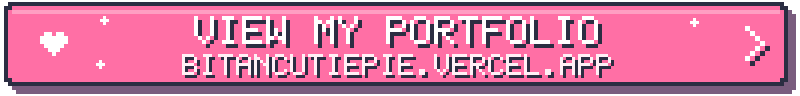
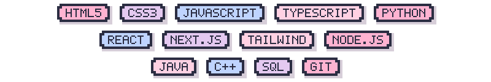
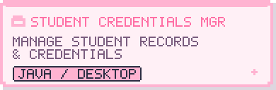
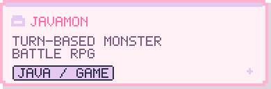
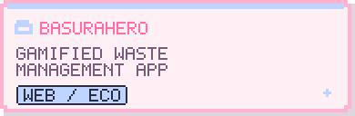
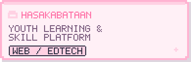

 

 

Hi, I'm **JV** (he/him), a 3rd-year BSIT student at **BatStateU** specializing in Business Analytics. I build practical full-stack web apps and enjoy turning data into useful tools.

- **Focus:** Full-Stack Web Development, Business Analytics, Data & Automation
- **Interests:** Gaming, coding
- **Portfolio:** [bitancutiepie.vercel.app](https://bitancutiepie.vercel.app)

 

 

 

 

