I love cute ♡

### ✿ Joshua Vincent M. Bitancor ✿

✦ Hello! My name is **JV** (*he*), a **BSIT – Business Analytics** student from the **Philippines**. 
✦ Currently studying: **Business Analytics**, **Data**, **Web Development**, **Automation** 
✦ I like **Gaming, Coding & Yearning**. 
✦ I love **cutiepie**, hence my username.

### ✿ Tech Stack ✿

### ✿ GitHub Stats ✿

### ✿ Quest Log ✿

~ main quests completed. click a card to play ~

